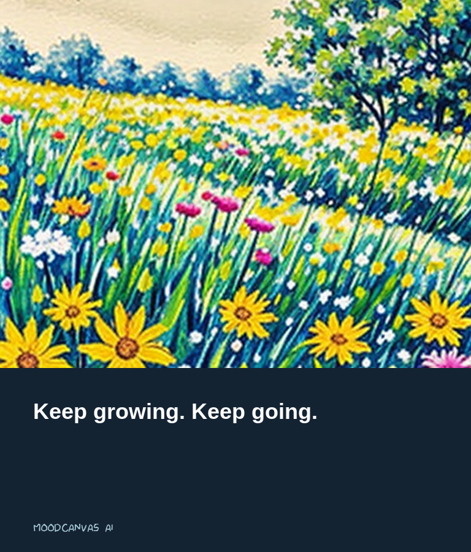
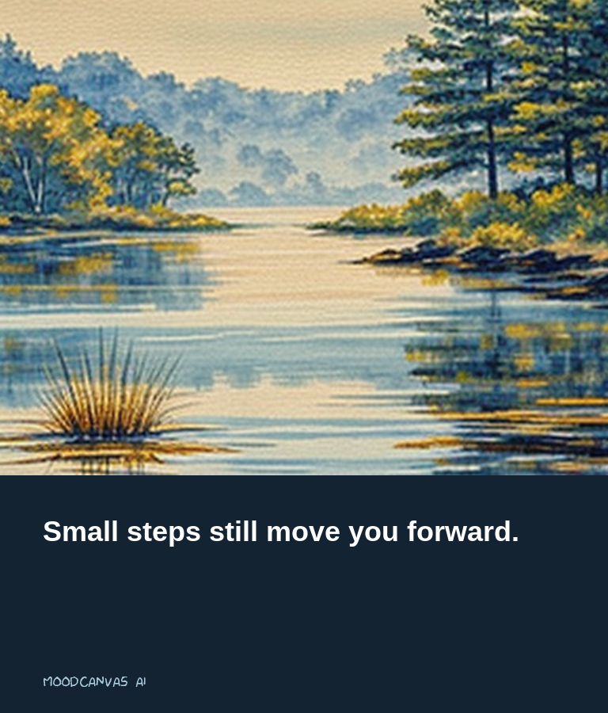
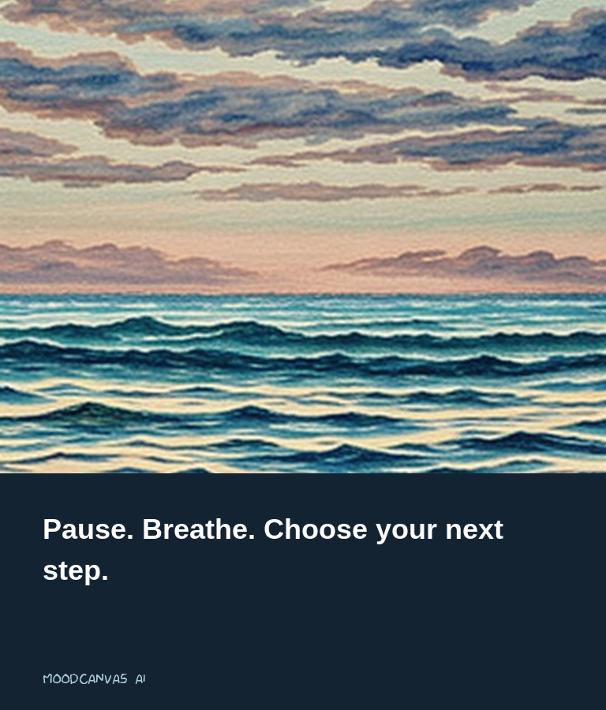
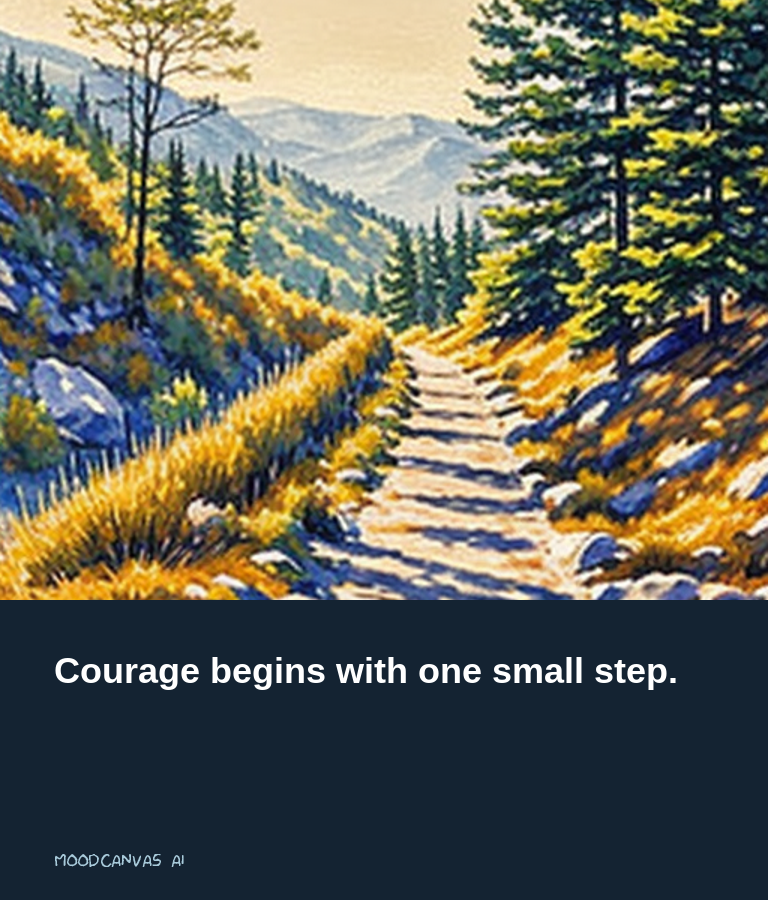

# MoodCanvas AI
## Emotion-Aware Motivational Poster Generation

MoodCanvas AI creates a motivational poster based on a sentence describing the user's mood. It combines emotion recognition with AI image generation.

## Team Members

- Shubham Bhatt — 202401100100246
- Yuvika Jindal — 202401100100290
- Section D

## How It Works

1. The user enters an English sentence about their mood.
2. A pretrained DistilRoBERTa model predicts the emotion.
3. Python selects a predefined motivational message and matching scene.
4. SD-Turbo generates the background image.
5. Pillow adds the message and saves a downloadable PNG poster.

For example, a sentence expressing fear can produce a peaceful mountain scene with the message “Courage begins with one small step.”

Both AI models are pretrained. We do not train or fine-tune a new model. The motivational messages come from a predefined collection.

## Technologies Used

- Python
- Google Colab
- PyTorch
- Transformers
- Diffusers
- Pillow
- scikit-learn

## How to Run

1. Open `MoodCanvas_AI.ipynb` in Google Colab.
2. Select **Runtime → Change runtime type → T4 GPU**.
3. Run the cells in order.
4. Change `mood_text` in the poster-generation cell.
5. Run that cell to display and download your poster.
6. Run the evaluation cell to calculate the demonstration scores.

An internet connection is required to download the models.

## Evaluation

The notebook tests emotion recognition on 14 manually labeled sentences, with two examples for each of the seven emotions.

The observed classroom demonstration achieved:

| Metric | Result |
| --- | --- |
| Accuracy | 100% |
| Macro-F1 | 1.000 |

These results apply only to the small demonstration set and do not establish general accuracy.

## Sample Outputs

The poster-generation cell displays the completed poster and downloads it as `MoodCanvas_Poster.png`.

The [sample_outputs](sample_outputs/) folder contains generated posters for joy, sadness, anger, and fear, along with their input descriptions.

### Joy


### Sadness


### Anger


### Fear


## Limitations

- Supports English input.
- May misinterpret sarcasm or mixed emotions.
- Uses a limited collection of motivational messages.
- Generated images may contain visual artifacts.
- Intended for creative use, not mental-health assessment.

## References

- [Emotion English DistilRoBERTa](https://huggingface.co/j-hartmann/emotion-english-distilroberta-base)
- [SD-Turbo](https://huggingface.co/stabilityai/sd-turbo)
```
